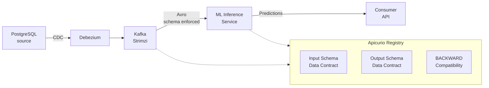

# Your Model Didn't Change, Your Input Did — Demo Walkthrough

> Status: historical scaffold, not yet verified end to end. The current abstract uses one structural compatibility check and a seconds/milliseconds feature-normalization test; the latter is not implemented here. API requests and serializer integration below also need verification. See [PREPARATION.txt](../PREPARATION.txt).

This walkthrough accompanies the **data-contracts-ai-pipelines** talk. Registry compatibility checks protect schema publication; producer integration and feature-input tests are separate controls. This scaffold does not establish an enforced producer-to-inference pipeline.

The demo reuses infrastructure patterns from the [debezium-ocp-etc-demo](debezium-ocp-etc-demo/) project.

## Architecture



## Prerequisites

1. A Kubernetes cluster (Minikube, Kind, or OpenShift)
2. [Strimzi Operator](https://strimzi.io/quickstarts/) installed
3. `kubectl` configured


## Step 1: Deploy the Infrastructure

Follow the installation steps in the [debezium-ocp-etc-demo README](debezium-ocp-etc-demo/README.md) to deploy:
- Apache Kafka (Strimzi)
- Apicurio Registry
- PostgreSQL
- Kafka Connect with Debezium

```bash
kubectl create namespace data-contracts

# Deploy Kafka, Registry, PostgreSQL, and Kafka Connect
# (refer to debezium-ocp-etc-demo/README.md for detailed steps)
```


## Step 2: Define the Data Contract (Input Schema)

Register the input schema — this is the **data contract** between the CDC producer and downstream consumers:

```bash
kubectl port-forward svc/apicurio-registry 8080:8080 -n data-contracts &

# Register the CDC event schema with BACKWARD compatibility
curl -X POST "http://localhost:8080/apis/registry/v3/groups/data-contracts/artifacts" \
  -H "Content-Type: application/json" \
  -H "X-Registry-ArtifactId: customer-events-value" \
  -H "X-Registry-ArtifactType: AVRO" \
  -d '{
    "type": "record",
    "name": "CustomerEvent",
    "namespace": "io.apicurio.demo",
    "fields": [
      {"name": "id", "type": "int"},
      {"name": "first_name", "type": "string"},
      {"name": "last_name", "type": "string"},
      {"name": "email", "type": "string"}
    ]
  }'

# BACKWARD: a new reader must be able to read data written with the old schema
curl -X POST "http://localhost:8080/apis/registry/v3/groups/data-contracts/artifacts/customer-events-value/rules" \
  -H "Content-Type: application/json" \
  -d '{"ruleType": "COMPATIBILITY", "config": "BACKWARD"}'

echo "Data contract registered with BACKWARD compatibility"
```

**Check before presenting:** show the actual schema selected by the CDC converter and consumer rather than assume a manually registered schema is used. BACKWARD compatibility concerns a new reader reading old data. Removing a field can be backward-compatible because the new reader ignores it; adding a required field without a default can make old records unreadable by the new reader.


## Step 3: Define the Output Contract (Predictions Schema)

Register the schema for the ML inference output:

```bash
curl -X POST "http://localhost:8080/apis/registry/v3/groups/data-contracts/artifacts" \
  -H "Content-Type: application/json" \
  -H "X-Registry-ArtifactId: predictions-value" \
  -H "X-Registry-ArtifactType: AVRO" \
  -d '{
    "type": "record",
    "name": "Prediction",
    "namespace": "io.apicurio.demo",
    "fields": [
      {"name": "customer_id", "type": "int"},
      {"name": "prediction", "type": "string"},
      {"name": "confidence", "type": "double"},
      {"name": "model_version", "type": "string"},
      {"name": "timestamp", "type": "long"}
    ]
  }'

curl -X POST "http://localhost:8080/apis/registry/v3/groups/data-contracts/artifacts/predictions-value/rules" \
  -H "Content-Type: application/json" \
  -d '{"ruleType": "COMPATIBILITY", "config": "BACKWARD"}'
```

**Demo point:** Now there are two data contracts — one for the input (CDC events) and one for the output (predictions). Both are governed by the same registry with the same compatibility rules.


## Step 4: Show the CDC Pipeline in Action

Deploy the Debezium source connector (from the debezium-ocp-etc-demo):

```bash
# Apply the PostgreSQL connector
kubectl apply -f debezium-ocp-etc-demo/connectors/source-postgres-connector.yaml -n data-contracts
```

Insert data into PostgreSQL:
```bash
kubectl exec -it postgres -n data-contracts -- psql --user postgres -c \
  "INSERT INTO inventory.customers VALUES (1005, 'Alice', 'Smith', 'alice@example.com');"
```

**Demo point:** Show the CDC event in Kafka (via Kafka UI or console consumer). The event is serialized in Avro using the registered schema. The schema ID is embedded in the message header — any consumer can look up the schema from the registry to deserialize.


## Step 5: Demonstrate a Compatible Schema Change

```bash
# Add an optional field (compatible change)
curl -X POST "http://localhost:8080/apis/registry/v3/groups/data-contracts/artifacts/customer-events-value/versions" \
  -H "Content-Type: application/json" \
  -d '{
    "type": "record",
    "name": "CustomerEvent",
    "namespace": "io.apicurio.demo",
    "fields": [
      {"name": "id", "type": "int"},
      {"name": "first_name", "type": "string"},
      {"name": "last_name", "type": "string"},
      {"name": "email", "type": "string"},
      {"name": "segment", "type": ["null", "string"], "default": null}
    ]
  }'

echo "Version 2 registered — added optional 'segment' field"
```

**Demo point:** This succeeds because adding a nullable field with a default is backward compatible. Existing consumers continue to work — they simply ignore the new field. New consumers can use it for ML feature enrichment.


## Step 6: Demonstrate a Breaking Schema Change

```bash
# Try to remove a required field (breaking change)
curl -s -X POST "http://localhost:8080/apis/registry/v3/groups/data-contracts/artifacts/customer-events-value/versions" \
  -H "Content-Type: application/json" \
  -d '{
    "type": "record",
    "name": "CustomerEvent",
    "namespace": "io.apicurio.demo",
    "fields": [
      {"name": "id", "type": "int"},
      {"name": "full_name", "type": "string"},
      {"name": "email", "type": "string"}
    ]
  }'
```

**Expected check, not a verified result:** adding required `full_name` without a default prevents the new reader from reading old records under BACKWARD compatibility. The removed fields raise a separate question for old readers consuming new data. Assert the registry response and the relevant reader/writer behavior independently; this scaffold does not demonstrate a prevented production incident.


## Key Talking Points

1. **Structure and meaning** — Schema compatibility and feature semantics require different checks. The current talk pairs one Avro revision with a unit-normalization fixture.
2. **Enforcement points** — Registry publication rules, configured serializers and CI tests enforce different boundaries. A registry alone does not inspect every Kafka write.
3. **CDC integration** — Verify the converter's emitted schema, envelope and consumer input before claiming a manually registered contract governs the pipeline.
4. **Keep the scope narrow** — Use Avro and one feature; additional format comparisons belong in backup material.
5. **Scope of schema checks** — Compatibility checks can reject incompatible schema registrations. They do not measure model quality, validate feature semantics, or protect against producers that bypass enforcement.
