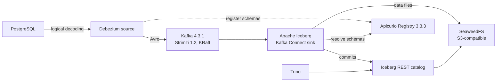

# The Sink Said RUNNING: CDC to Iceberg on Kubernetes — Demo Walkthrough

This walkthrough accompanies the **database-to-lakehouse-realtime** talk: a change data capture
pipeline from PostgreSQL into Apache Iceberg, with schemas managed in Apicurio Registry.

**Status: verified end to end on September 28, 2026**, twice from a clean namespace, on minikube
(Kubernetes 1.28, podman driver, macOS arm64). Every number and output below was observed in
those runs.

## Architecture



| Component | Version | Notes |
|---|---|---|
| Strimzi | 1.2.0 | `kafka.strimzi.io/v1` API, KRaft with a `KafkaNodePool` |
| Kafka / Kafka Connect | 4.3.1 | Custom Connect image, see `connect-image/` |
| Debezium PostgreSQL connector | 3.6.3.Final | `pgoutput`, table `inventory.customers` |
| Apicurio Registry + Connect converter | 3.3.3 | `io.apicurio.registry.utils.converter.AvroConverter` |
| Apache Iceberg Kafka Connect sink | 1.11.0 | Built from the Apache source release |
| Iceberg REST catalog | `apache/iceberg-rest-fixture:1.10.1` | Reference implementation; in-memory catalog |
| Object storage | SeaweedFS 3.97 | MinIO container images are no longer published |
| Trino | 480 | Iceberg REST catalog connector |

## Run It

```bash
./connect-image/build.sh      # build the Connect image (JDK 17/21, Docker); loads it into minikube
./scripts/01-deploy.sh        # Strimzi + all components in namespace lakehouse-demo
./scripts/run-demo.sh         # insert, schema evolution, snapshots / time travel
./scripts/99-teardown.sh      # delete the namespace
```

| Script | What it shows |
|---|---|
| `01-deploy.sh` | Deploys everything and waits for Debezium's initial snapshot (4 rows) to land in Iceberg |
| `02-insert-and-query.sh` | Inserts customer 1005 and measures time until it is queryable |
| `03-schema-evolution.sh` | `ADD COLUMN phone`: new registry version, column added to the Iceberg table |
| `04-time-travel.sh` | Snapshot history, `FOR VERSION AS OF`, latest state per key |

## Observed Results

**Initial snapshot.** Debezium snapshots the 4 existing customers; they are queryable in Iceberg
122 s after the connectors report Ready (includes table creation and the first commits).

**Freshness.** An inserted row became queryable after **33 s and 42 s** in two runs, with
`iceberg.control.commit.interval-ms: 10000`. Snapshots landed roughly **once a minute**. The
connector's **default commit interval is 300000 ms (5 minutes)**. Freshness here is seconds to
a minute, bounded by the sink's commit cycle — not sub-second.

**Schema evolution.** `ALTER TABLE ... ADD COLUMN phone` produced value-schema **version 2** in
Apicurio Registry, and the sink added the `phone` column to the Iceberg table with
`iceberg.tables.evolve-schema-enabled: true` — no manual DDL. The updated value was queryable
after **51 s and 59 s**. Only an additive, nullable change was tested.

**Changelog, not a mirror.** `DebeziumTransform` flattens change events and adds a `_cdc` struct
(`op`, `offset`, `source`, ...). The sink **appends**: after the update, customer 1005 has an
`I` row and a `U` row. Current state needs a query such as:

```sql
SELECT id, first_name, last_name, phone
FROM (SELECT *, row_number() OVER (PARTITION BY id ORDER BY _cdc.offset DESC) AS rn
      FROM iceberg.inventory.customers)
WHERE rn = 1 AND _cdc.op <> 'D'
```

**Snapshots and time travel.** One Iceberg snapshot per sink commit (3 snapshots: 4, 1, 1 added
records), not one per change event. `FOR VERSION AS OF <first snapshot>` returns the original
4 customers.

## Problems Found While Building This (useful talk material)

1. **Corrupted metadata on S3-compatible storage.** Iceberg's `S3FileIO` uses AWS SDK v2, whose
   default checksums use `aws-chunked` uploads. SeaweedFS stored the chunk framing inside the
   object, so reading `metadata.json` failed with `Unexpected character ('f')`. Fix:
   `AWS_REQUEST_CHECKSUM_CALCULATION=when_required` and
   `AWS_RESPONSE_CHECKSUM_VALIDATION=when_required` on every writer (catalog and Connect).
2. **Signed requests need an S3 identity.** SeaweedFS rejects signed requests until an identity
   is configured (`-s3.config`).
3. **Sink control consumer never stayed in its group.** Under the classic rebalance protocol the
   sink's control-topic consumer hit `UNKNOWN_MEMBER_ID` on SyncGroup, so every commit timed out
   with `committed to 0 table(s)` while the task reported RUNNING. Switching that consumer to
   Kafka 4's consumer protocol (`iceberg.kafka.group.protocol: consumer`, KIP-848) fixed it.
   Root cause not investigated further; worth reporting upstream with a reproducer.
4. **Strimzi 1.x** accepts only the `v1` API, and still needs the
   `strimzi.io/use-connector-resources` annotation for `KafkaConnector` resources.

## Not Covered or Not Measured

- Updates/deletes applied as merges (upsert) — the sink appends; deletes are `D` rows.
- Breaking schema changes (drops, type changes) and registry compatibility rules — not tested.
- Throughput, resource use, or latency under load — only single-row timings were measured.
- Production concerns: compaction of small files, snapshot expiry, catalog persistence, security.
- Flink — this demo uses Kafka Connect only.
