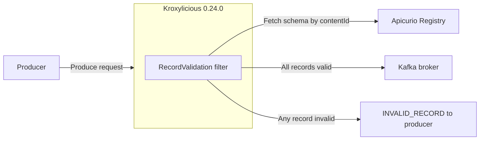

# Validate Before Kafka — Demo Walkthrough

This walkthrough accompanies the **kafka-proxy-schema-validation** talk. It uses the
**Record Validation filter shipped in Kroxylicious** to validate record values against a
JSON Schema stored in Apicurio Registry before produce requests reach the broker.

Carles contributed the filter's Avro and Protobuf schema validation support:
[kroxylicious/kroxylicious#3498](https://github.com/kroxylicious/kroxylicious/pull/3498),
merged April 29, 2026 and first released in Kroxylicious 0.21.0.
The filter is documented upstream as a **Preview** feature.

**Status: verified end to end on September 28, 2026** with Kroxylicious 0.24.0,
Apicurio Registry 3.3.3, and Apache Kafka 3.9.1 (Docker, macOS arm64).
Every result quoted below was observed in that run.

## Architecture



## Prerequisites

- Docker with Compose
- `curl` and `jq`

No Java build is required: the demo uses the released `quay.io/kroxylicious/proxy` image.

## Run It

```bash
cd kafka-proxy-demo
./scripts/run-demo.sh      # pauses between steps
./scripts/99-stop.sh       # clean up
```

All clients run inside the `kafka` container on the Compose network; the proxy is
reachable at `kroxylicious:9192`, the broker directly at `kafka:9092`.

| Script | What it does |
|---|---|
| `00-start.sh` | Start Kafka and Apicurio Registry |
| `01-register-schema.sh` | Register the order schema via the v3 API, render the proxy config with its `contentId`, start Kroxylicious |
| `02-create-topic.sh` | Create the `orders` topic |
| `03-produce-valid.sh` | Valid order through the proxy |
| `04-produce-invalid.sh` | Three invalid orders through the proxy |
| `05-verify-kafka.sh` | Read the topic directly from the broker |
| `06-mixed-batch.sh` | Valid + invalid record in one produce request |
| `07-bypass.sh` | Invalid record sent straight to the broker |
| `08-registry-outage.sh` | Valid record while the registry is stopped |

## Filter Configuration

`proxy-config.template.yaml` — `apicurioId` is the schema's **contentId**, filled in at runtime:

```yaml
filterDefinitions:
  - name: order-validation
    type: RecordValidation
    config:
      rules:
        - topicNames: [orders]
          valueRule:
            schemaValidationConfig:
              apicurioRegistryUrl: http://apicurio-registry:8080
              apicurioId: __CONTENT_ID__
              schemaType: JSON_SCHEMA
defaultFilters:
  - order-validation
```

## Observed Results

**Valid order — accepted.** `ORD-001` reaches the broker.

**Invalid orders — rejected with a precise reason.** The producer receives
`org.apache.kafka.common.InvalidRecordException`:

| Record | Error reported to the producer |
|---|---|
| Missing `currency` | `$: required property 'currency' not found` |
| `amount` is a string | `$.amount: string found, number expected` |
| `currency: BTC` | `$.currency: does not have a value in the enumeration ["USD", "EUR", "GBP"]` |

**Mixed batch — the whole batch is rejected.** A valid `ORD-005` sent in the same
batch as an invalid record is also rejected:
`Failed to append record because it was part of a batch which had one more more invalid records`.
Only `ORD-001` is in the topic afterwards. Producers must treat this as a batch-level
failure: resend the valid records, and don't retry the invalid one.

**Bypass — accepted by the broker.** An invalid record sent to `kafka:9092` directly is
stored. Proxy validation only covers clients that go through the proxy; enforce the path
with network policy and broker authorization.

**Registry outage — fails closed.** With Apicurio Registry stopped, a *valid* record is
rejected with `context=SCHEMA_RESOLUTION_ERROR`. It arrives as the same
`InvalidRecordException` used for bad data, so a producer cannot distinguish
"your record is invalid" from "the registry is unreachable" by exception type alone.
This happened even though the schema had been fetched successfully earlier.

## Key Talking Points

1. **Enforcement on the write path** — producers keep their existing clients; they connect to the proxy.
2. **Specific errors** — rejections name the exact JSON path and constraint that failed.
3. **Batch semantics** — one bad record rejects its whole batch; plan producer error handling around it.
4. **Not a perimeter** — direct broker access skips validation; combine with network controls and ACLs.
5. **Availability trade-off** — the registry becomes a write-path dependency; the observed behavior is fail-closed.
6. **Complements client-side validation** — serializers with the same registry remain the first line; the proxy covers clients you can't change.

## Not Covered by This Demo

- Avro and Protobuf validation (supported via `schemaType`; not exercised here).
- Latency or throughput overhead — not measured; don't quote numbers.
- Schema caching configuration and TTLs.
